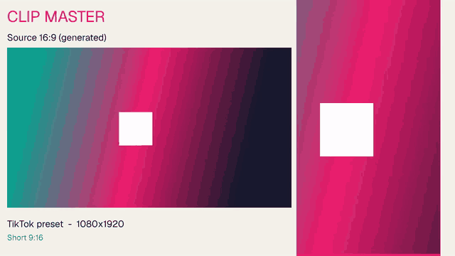
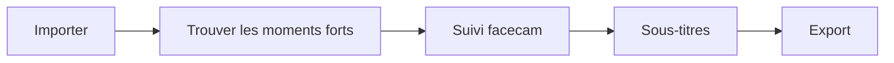

<div align="center">

# CLIP MASTER

**Transforme n'importe quelle longue vidéo en Short 9:16 sous-titré, sur ta machine.**
Trouve le meilleur moment, suit le sujet, incruste les sous-titres, exporte pour TikTok, YouTube Shorts ou Instagram Reels.

[](https://github.com/sekhoutoure/clip-master/actions/workflows/ci.yml)
[](LICENSE)
[](#prérequis)
[](https://github.com/sekhoutoure/clip-master/releases)
[](#mode-ia-avec-ou-sans-clé)

[English](README.md) | Français



<sub>Démo réalisée avec des médias générés uniquement. [Version MP4](docs/media/demo.mp4) · [Capture de l'interface](docs/media/ui.png)</sub>

</div>

## Démarrage rapide

```bash
git clone https://github.com/sekhoutoure/clip-master && cd clip-master
./install.sh            # Windows : .\install.ps1
./start.sh              # Windows : start.bat   ->  http://127.0.0.1:7866
```

L'installeur prépare un environnement virtuel, les paquets Python, FFmpeg et Node.js si tu l'autorises (`--yes`), les modèles et les outils tiers. Tu peux le relancer sans risque. `./install.sh --check` indique ce qui manque.

**Tu utilises un agent de code ?** Voir [Installer avec un agent IA](#installer-avec-un-agent-ia).

## Fonctionnalités

- **Import** depuis un lien (YouTube, Twitch, X et [beaucoup d'autres sites](https://github.com/yt-dlp/yt-dlp/blob/master/supportedsites.md)), un live, une VOD Twitch avec chat, ou un MP4 local.
- **Trouver le moment** : coupes de scène, suppression des silences, choix du temps fort par énergie audio et directeur LLM optionnel.
- **Suivre le sujet** : la facecam est détectée et l'action est suivie ; le recadrage 9:16 suit le sujet avec la facecam en incrustation.
- **Sous-titres** : transcription locale mot à mot, styles TikTok, modifiables dans l'interface, sous-titres animés en option.
- **Préréglages d'export** pour **TikTok, YouTube Shorts et Instagram Reels** : durée max, zones sûres, styles de sous-titres. 1080×1920, 30 i/s, -14 LUFS, contrôle qualité intégré.
- **File d'attente** : colle plusieurs liens ou dépose plusieurs fichiers ; ils sont traités un par un, annulables, relançables, et reprennent après un redémarrage.
- **Interface FR / EN** avec bascule, et **traduction automatique des sous-titres** (fr, en, es, de, pt, it, ar).
- **Local d'abord** : rien n'est envoyé. Transcription et rendu tournent sur ta machine.
- **GPU si disponible** : CUDA est détecté au démarrage (`CLIP_MASTER_DEVICE=auto`). La transcription (float16) et le suivi du sujet passent alors sur le GPU ; sinon ils restent sur CPU (int8). DirectML n'est pas activé automatiquement.
- **Nettoyage disque** : les dossiers de travail, fichiers intermédiaires et exports de plus de 48 h sont purgés au démarrage et périodiquement (`CLIP_MASTER_CACHE_TTL_HOURS=0` désactive le passage automatique). Un garde-fou peut refuser de nouveaux traitements s'il reste trop peu d'espace. Bouton **Vider le cache & anciens exports** ou `clip-master clean`.

## Pipeline



## Prérequis

| | |
|---|---|
| Python | 3.10 à 3.12 (3.13 peut manquer de certaines roues vision / PyTorch) |
| FFmpeg | avec libass ; l'installeur peut l'installer, sinon repli sur `imageio-ffmpeg` |
| Node.js 18+ | optionnel, seulement pour les sous-titres animés |
| Disque / RAM | plusieurs Go de disque (bien moins avec PyTorch CPU, `--cpu-torch`), 8 Go de RAM conseillés |
| Internet | à l'installation (paquets, modèles), puis pour télécharger des vidéos |

## Installation

| | Linux / macOS | Windows (PowerShell) |
|---|---|---|
| Installer | `./install.sh` | `.\install.ps1` |
| Installer aussi FFmpeg / Node | `./install.sh --yes` | `.\install.ps1 -Yes` |
| Sans GPU (petit PyTorch) | `./install.sh --cpu-torch` | `.\install.ps1 -CpuTorch` |
| Vérifier | `./install.sh --check` | `.\install.ps1 -Check` |
| Lancer | `./start.sh` | `start.bat` |

Une fois installé : `clip-master serve`, `clip-master doctor`, `clip-master install`, `clip-master clean`.
Les outils tiers (versions figées, licences, rôle) sont listés dans [`third_party/manifest.yml`](third_party/manifest.yml). Ils sont téléchargés sur ta machine, jamais stockés dans ce dépôt. `--with-reference` récupère aussi les sources de référence.

## Utilisation

1. **Importer** : colle un lien ou dépose un MP4.
2. **Style** : *Standard* (facecam + jeu) ou *Suivi* (le recadrage suit le sujet). Choisis une **Plateforme** (TikTok, YouTube Shorts, Instagram Reels) et, au besoin, une langue pour traduire les sous-titres.
3. **Créer le Short**. Le fichier arrive dans `outputs/`, avec titre et hashtags prêts à copier.
4. Beaucoup de vidéos ? Utilise la carte **File d'attente**.

Tout est aussi disponible en HTTP pour les scripts (`/api/pull`, `/api/stage/full`, `/api/queue`, …) : voir [`skills/make-a-short-from-vod/SKILL.md`](skills/make-a-short-from-vod/SKILL.md).

### Préréglages d'export

| Préréglage | Durée max | Bas de l'écran laissé libre | Style de sous-titres par défaut |
|---|---|---|---|
| TikTok | 180 s | 22 % | `tiktok_white` |
| YouTube Shorts | 180 s | 18 % | `white` |
| Instagram Reels | 90 s | 24 % | `white` |

Les valeurs sont dans [`presets.py`](presets.py) ; les plateformes changent leurs limites, ajuste-les là.

## Configuration

Copie `.env.example` en `.env` (l'installeur le fait). Tout est optionnel : voir le tableau de la [version anglaise](README.md#configuration), y compris `CLIP_MASTER_CACHE_TTL_HOURS`, `CLIP_MASTER_MIN_FREE_MB` et `CLIP_MASTER_DEVICE`.

### Mode IA : avec ou sans clé

- **Avec `GROQ_API_KEY`** : choix du temps fort, polissage des sous-titres et traduction passent par Groq.
- **Sans clé (mode sans clé)** : les mêmes fonctions utilisent **Ollama en local** : installe [Ollama](https://ollama.com), lance `ollama pull qwen2.5:7b`, c'est tout. Un badge dans la barre du haut indique le mode actif.
- **La transcription est toujours locale** (faster-whisper) et ne demande jamais de clé.
- Aucun des deux ? Le temps fort est choisi par énergie audio ; la traduction demande un LLM.

## Installer avec un agent IA

Donne ce texte à ton agent de code (Claude Code, Cursor, Codex, Copilot, Aider…) :

```text
Installe CLIP MASTER sur cette machine : clone https://github.com/sekhoutoure/clip-master, lis AGENTS.md,
lance l'installeur (./install.sh --yes, ou .\install.ps1 -Yes sous Windows) puis le diagnostic
(./install.sh --check). Corrige tout ce que le diagnostic signale, lance les tests (pytest -m "not slow"),
démarre l'application et donne-moi l'URL. Ne me demande pas de clé API : l'appli marche sans.
```

Le dépôt contient [`AGENTS.md`](AGENTS.md), [`CLAUDE.md`](CLAUDE.md), une règle Cursor et des skills dans [`skills/`](skills) (copie dans `.claude/skills/`) : `install-clip-master`, `make-a-short-from-vod`, `batch-clips`, `export-presets`, `troubleshoot`.

## FAQ et dépannage

**Faut-il une clé API ?** Non. Voir [Mode IA](#mode-ia-avec-ou-sans-clé).

**`FFmpeg not found` ou sous-titres absents de l'export.** Installe un FFmpeg complet (`winget install Gyan.FFmpeg`, `brew install ffmpeg`, `sudo apt install ffmpeg`) ou renseigne `FFMPEG_PATH`.

**L'installation est énorme.** Utilise `--cpu-torch` si tu n'as pas de GPU. Avec un GPU CUDA, laisse `CLIP_MASTER_DEVICE=auto` pour que la transcription et le suivi du sujet l'utilisent.

**Le disque se remplit de vieux projets.** Le nettoyage automatique supprime les dossiers de travail et les exports de plus de 48 h. Clique **Vider le cache & anciens exports** ou lance `clip-master clean` (ajoute `--all` pour aussi enlever le travail inutilisé encore dans le TTL). La tâche en cours et le fichier de file d'attente ne sont jamais effacés.

**Un téléchargement échoue (403, connexion requise).** Mets le téléchargeur à jour (`pip install -U yt-dlp` dans `.venv`), essaie un lien direct, ou télécharge le fichier toi-même et importe le MP4.

**Le badge indique « Local · Ollama indisponible ».** Démarre Ollama et lance `ollama pull qwen2.5:7b`, ou ajoute une clé Groq, ou mets `LLM_PROVIDER=none`.

**Puis-je découper n'importe quelle vidéo ?** Uniquement des contenus dont tu as les droits (les tiens, sous licence, ou autorisés par le créateur et la plateforme). Tu es responsable de ce que tu importes, transformes et publies. Le projet n'est affilié à aucune plateforme, éditeur de jeu ou créateur.

Autres cas : [`skills/troubleshoot/SKILL.md`](skills/troubleshoot/SKILL.md). Joins la sortie de `./install.sh --check` à tes rapports de bug.

## Contribuer

Les contributions sont bienvenues : voir [CONTRIBUTING.md](CONTRIBUTING.md). Boucle rapide : `ruff check .` puis `pytest -m "not slow"`. Les changements sont dans [CHANGELOG.md](CHANGELOG.md).

## Licence

[AGPL-3.0](LICENSE). Ultralytics YOLO (AGPL-3.0) est une dépendance directe : tout le projet est donc en AGPL-3.0. Si tu fais tourner une version modifiée comme service réseau, tu dois en offrir le code source à ses utilisateurs.
**Remotion** (optionnel) est « source-available » : gratuit pour les particuliers et petites équipes, licence payante pour les grandes sociétés ([conditions](https://github.com/remotion-dev/remotion/blob/main/LICENSE.md)).

## Crédits

CLIP MASTER s'appuie sur [FFmpeg](https://ffmpeg.org), [yt-dlp](https://github.com/yt-dlp/yt-dlp), [Streamlink](https://github.com/streamlink/streamlink), [TwitchDownloader](https://github.com/lay295/TwitchDownloader), [PySceneDetect](https://github.com/Breakthrough/PySceneDetect), [auto-editor](https://github.com/WyattBlue/auto-editor), [faster-whisper](https://github.com/SYSTRAN/faster-whisper), [MediaPipe](https://github.com/google-ai-edge/mediapipe), [Ultralytics](https://github.com/ultralytics/ultralytics), [Demucs](https://github.com/facebookresearch/demucs), [Remotion](https://github.com/remotion-dev/remotion), [FastAPI](https://fastapi.tiangolo.com), et s'inspire de FunClip, ClipsAI, WhisperX, OpenCut et d'autres. Liste complète, licences et marques : [NOTICE.md](NOTICE.md).
