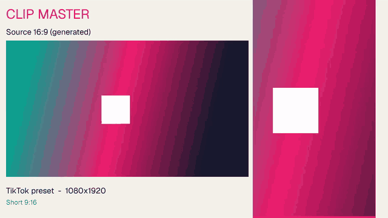
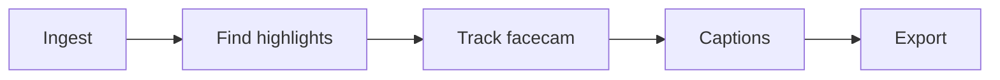

<div align="center">

# CLIP MASTER

**Turn any long video into a captioned 9:16 Short, on your own machine.**
Find the best moment, track the subject, burn the captions, export for TikTok, YouTube Shorts or Instagram Reels.

[](https://github.com/sekhoutoure/clip-master/actions/workflows/ci.yml)
[](LICENSE)
[](#requirements)
[](https://github.com/sekhoutoure/clip-master/releases)
[](#ai-mode-with-or-without-a-key)

English | [Français](README.fr.md)



<sub>Demo made from generated media only. [MP4 version](docs/media/demo.mp4) · [UI screenshot](docs/media/ui.png)</sub>

</div>

## Quick start

```bash
git clone https://github.com/sekhoutoure/clip-master && cd clip-master
./install.sh            # Windows: .\install.ps1
./start.sh              # Windows: start.bat   ->  http://127.0.0.1:7866
```

The installer sets up a virtualenv, the Python packages, FFmpeg and Node.js if you allow it (`--yes`), the model weights and the third-party tools. It is safe to run again. `./install.sh --check` tells you what is missing.

**Using a coding agent?** See [Install with an AI agent](#install-with-an-ai-agent).

## Features

- **Import** from a link (YouTube, Twitch, X and [many other sites](https://github.com/yt-dlp/yt-dlp/blob/master/supportedsites.md)), a live stream, a Twitch VOD with chat, or a local MP4.
- **Find the moment**: scene cuts, silence removal, highlight picking from audio energy and an optional LLM director.
- **Track the subject**: the facecam is detected and the action is followed; the 9:16 crop follows it with the facecam inset on top.
- **Captions**: local word-level transcription, TikTok-style presets, editable in the UI, optional animated captions.
- **Export presets** for **TikTok, YouTube Shorts and Instagram Reels**: length cap, caption safe zones, caption styles. 1080×1920, 30 fps, -14 LUFS, built-in quality check.
- **Batch queue**: paste many links or drop many files; items run one by one, can be cancelled or retried, and survive a restart.
- **French / English UI** with a toggle, and **automatic subtitle translation** (fr, en, es, de, pt, it, ar).
- **Local first**: nothing is uploaded. Transcription and rendering run on your machine.
- **GPU when available**: CUDA is detected at startup (`CLIP_MASTER_DEVICE=auto`). Transcription (float16) and subject tracking then run on the GPU; otherwise they stay on CPU (int8). DirectML is not auto-enabled.
- **Disk cleanup**: workdirs, intermediate files and exports older than 48 hours are purged at startup and periodically (`CLIP_MASTER_CACHE_TTL_HOURS=0` disables the automatic pass). A low-disk guard can refuse new jobs. Use the **Clear cache & old exports** button or `clip-master clean`.

## Pipeline



## Requirements

| | |
|---|---|
| Python | 3.10 to 3.12 (3.13 may lack some vision / PyTorch wheels) |
| FFmpeg | with libass; the installer can install it, or it falls back to the bundled `imageio-ffmpeg` |
| Node.js 18+ | optional, only for animated captions |
| Disk / RAM | several GB of disk (much less with the PyTorch CPU build, `--cpu-torch`), 8 GB RAM recommended |
| Internet | first install only (packages, model weights), then for downloading videos |

## Installation

| | Linux / macOS | Windows (PowerShell) |
|---|---|---|
| Install | `./install.sh` | `.\install.ps1` |
| Also install FFmpeg / Node | `./install.sh --yes` | `.\install.ps1 -Yes` |
| No GPU (small PyTorch) | `./install.sh --cpu-torch` | `.\install.ps1 -CpuTorch` |
| Check the setup | `./install.sh --check` | `.\install.ps1 -Check` |
| Start | `./start.sh` | `start.bat` |

Also available once installed: `clip-master serve`, `clip-master doctor`, `clip-master install`, `clip-master clean`.
Third-party tools (pinned versions, licenses, purpose) are listed in [`third_party/manifest.yml`](third_party/manifest.yml). They are downloaded on your machine, never stored in this repository. Add `--with-reference` to also fetch the reference-only sources.

## Usage

1. **Import**: paste a link or drop an MP4.
2. **Style**: *Standard* (facecam + game) or *Tracked* (the crop follows the subject). Pick a **Platform** (TikTok, YouTube Shorts, Instagram Reels) and, optionally, a language to translate the subtitles.
3. **Create the Short**. The file lands in `outputs/`, with a title and hashtags ready to copy.
4. Many videos? Use the **Batch queue** card.

For scripting, everything is available over HTTP (`/api/pull`, `/api/stage/full`, `/api/queue`, …). See [`skills/make-a-short-from-vod/SKILL.md`](skills/make-a-short-from-vod/SKILL.md).

### Export presets

| Preset | Max length | Bottom area kept clear | Default caption style |
|---|---|---|---|
| TikTok | 180 s | 22% | `tiktok_white` |
| YouTube Shorts | 180 s | 18% | `white` |
| Instagram Reels | 90 s | 24% | `white` |

Values live in [`presets.py`](presets.py); platforms change their limits, so adjust them there.

## Configuration

Copy `.env.example` to `.env` (the installer does it). Everything is optional.

| Variable | Default | Meaning |
|---|---|---|
| `GROQ_API_KEY` | empty | Cloud LLM. Empty = local Ollama |
| `LLM_PROVIDER` | `auto` | `auto`, `groq`, `ollama` or `none` |
| `OLLAMA_URL` / `OLLAMA_MODEL` | `http://localhost:11434` / `qwen2.5:7b` | Local LLM |
| `CLIP_MASTER_HOST` / `CLIP_MASTER_PORT` | `127.0.0.1` / `7866` | Where the app listens |
| `CLIP_MASTER_MAX_UPLOAD_MB` | `2048` | Upload size limit |
| `CLIP_MASTER_DOWNLOAD_TIMEOUT` | `1800` | Download timeout in seconds |
| `CLIP_MASTER_DATA_DIR` | repo folder | Where `projects/`, `outputs/`, `models/` live |
| `CLIP_MASTER_PROJECTS_DIR` / `OUTPUTS_DIR` / `MODELS_DIR` / `BIN_DIR` | under the data dir | Override a single folder |
| `FFMPEG_PATH`, `TWITCHDOWNLOADER_CLI` | empty | Use a specific binary |
| `CLIP_MASTER_ALLOWED_HOSTS` | empty | Extra `Host` headers to allow, comma-separated |
| `CLIP_MASTER_CACHE_TTL_HOURS` | `48` | Auto-purge age for workdirs, intermediates and exports (`0` disables automatic cleanup) |
| `CLIP_MASTER_MIN_FREE_MB` | `1024` | Refuse new jobs below this free space (`0` disables the guard) |
| `CLIP_MASTER_CACHE_SWEEP_SECONDS` | `1800` | Periodic sweep interval (`0` disables the background sweeper) |
| `CLIP_MASTER_DEVICE` | `auto` | `auto`, `cpu` or `cuda` (CUDA falls back to CPU if no GPU is found) |

### AI mode: with or without a key

- **With `GROQ_API_KEY`**: highlight selection, caption polish and translation use Groq.
- **Without a key (no-key mode)**: the same features use **local Ollama**: install [Ollama](https://ollama.com), run `ollama pull qwen2.5:7b`, done. A badge in the top bar shows the active mode.
- **Transcription is always local** (faster-whisper) and never needs a key.
- Neither available? Highlights fall back to audio-energy heuristics; translation needs an LLM.

## Install with an AI agent

Give your coding agent (Claude Code, Cursor, Codex, Copilot, Aider…) this prompt:

```text
Install CLIP MASTER on this machine: clone https://github.com/sekhoutoure/clip-master, read AGENTS.md,
then run the installer (./install.sh --yes, or .\install.ps1 -Yes on Windows) and the doctor
(./install.sh --check). Fix anything the doctor reports, run the tests (pytest -m "not slow"),
start the app and tell me the URL. Do not ask me for API keys: the app works without one.
```

The repo ships [`AGENTS.md`](AGENTS.md), [`CLAUDE.md`](CLAUDE.md), a Cursor rule and task skills in [`skills/`](skills) (mirrored in `.claude/skills/`): `install-clip-master`, `make-a-short-from-vod`, `batch-clips`, `export-presets`, `troubleshoot`.

## FAQ and troubleshooting

**Do I need an API key?** No. See [AI mode](#ai-mode-with-or-without-a-key).

**`FFmpeg not found` or captions are missing in the export.** Install a full FFmpeg (`winget install Gyan.FFmpeg`, `brew install ffmpeg`, `sudo apt install ffmpeg`) or set `FFMPEG_PATH`.

**The install is very large.** Use `--cpu-torch` if you have no GPU. With a CUDA GPU, leave `CLIP_MASTER_DEVICE=auto` so transcription and subject tracking use it.

**The disk fills up with old projects.** Automatic cleanup removes workdirs and exports older than 48 hours. Click **Clear cache & old exports** or run `clip-master clean` (add `--all` to also remove unused work still inside the TTL). The current job and the queue file are never deleted.

**A download fails (403, sign-in required).** Update the downloader (`pip install -U yt-dlp` in `.venv`), try a direct link, or download the file yourself and upload the MP4.

**The badge says "Local · Ollama unavailable".** Start Ollama and run `ollama pull qwen2.5:7b`, or add a Groq key, or set `LLM_PROVIDER=none`.

**Is it legal to clip any video?** Only process content you have the rights to (your own, licensed, or allowed by the creator and the platform). You are responsible for what you import, transform and publish. This project is not affiliated with any platform, game publisher or creator.

More cases: [`skills/troubleshoot/SKILL.md`](skills/troubleshoot/SKILL.md). Run `./install.sh --check` and include its output in bug reports.

## Contributing

Contributions are welcome: see [CONTRIBUTING.md](CONTRIBUTING.md). Quick loop: `ruff check .` and `pytest -m "not slow"`. Changes are tracked in [CHANGELOG.md](CHANGELOG.md).

## License

[AGPL-3.0](LICENSE). Ultralytics YOLO (AGPL-3.0) is a direct dependency, so the whole project is AGPL-3.0. If you run a modified version as a network service, you must offer its source to its users.
**Remotion** (optional) is source-available: free for individuals and small teams, a paid license applies to larger companies ([terms](https://github.com/remotion-dev/remotion/blob/main/LICENSE.md)).

## Credits

CLIP MASTER stands on [FFmpeg](https://ffmpeg.org), [yt-dlp](https://github.com/yt-dlp/yt-dlp), [Streamlink](https://github.com/streamlink/streamlink), [TwitchDownloader](https://github.com/lay295/TwitchDownloader), [PySceneDetect](https://github.com/Breakthrough/PySceneDetect), [auto-editor](https://github.com/WyattBlue/auto-editor), [faster-whisper](https://github.com/SYSTRAN/faster-whisper), [MediaPipe](https://github.com/google-ai-edge/mediapipe), [Ultralytics](https://github.com/ultralytics/ultralytics), [Demucs](https://github.com/facebookresearch/demucs), [Remotion](https://github.com/remotion-dev/remotion), [FastAPI](https://fastapi.tiangolo.com), and was inspired by FunClip, ClipsAI, WhisperX, OpenCut and others. Full list, licenses and trademark notes: [NOTICE.md](NOTICE.md).
